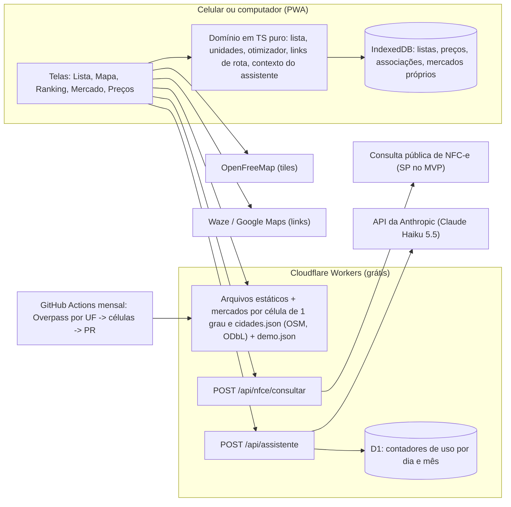

# Plano 0001: MVP do comparador da compra do mês

- Spec: [spec.md](spec.md)
- Data: 2026-11-10

## Contexto técnico

- Repositório novo: só a documentação existe. Segue o padrão dos sites do ecossistema (checklist de site novo do claude-works): TypeScript estrito, Vitest com 80% de cobertura, Playwright com axe, CodeQL, revisão de dependências, Dependabot com cooldown, `main` protegida.
- Referência mais próxima: lojinha-da-lua (Astro + ilha React no Cloudflare Workers, CSP por hash, prévia por branch, conferência diária de produção). O MVP reaproveita esse padrão para não reinventar CI, cabeçalhos e E2E.
- Restrições do dono: custo zero, nada pago sem perguntar, biblioteca nova só com OK (esta spec pede o OK das listadas abaixo), segredo só em cofre do provedor, toda decisão vira ADR.

## Fatos verificados

Pesquisa de 2026-11-10. Planos e termos mudam; conferir de novo antes de cada ADR.

| Fato                                                                                                                                                                                                                                                                                                                                                                                                                          | Fonte                                                                                                                                                                                                                                                              |
| ----------------------------------------------------------------------------------------------------------------------------------------------------------------------------------------------------------------------------------------------------------------------------------------------------------------------------------------------------------------------------------------------------------------------------- | ------------------------------------------------------------------------------------------------------------------------------------------------------------------------------------------------------------------------------------------------------------------ |
| O Menor Preço Brasil (Procergs/Sefaz-RS, convênio do Confaz) compara preços a partir de NF-e e NFC-e, exige login gov.br desde 2020 justamente para reduzir coleta automatizada, e nenhuma fonte menciona API ou dados abertos.                                                                                                                                                                                               | [Sefaz-ES, 13/11/2020](https://sefaz.es.gov.br/menor-preco-brasil-passa-ser-unico-aplicativo); [Governo do RS, 21/03/2026](https://estado.rs.gov.br/menor-preco-brasil-tecnologia-do-governo-gaucho-que-coloca-economia-na-palma-da-mao-de-milhoes-de-brasileiros) |
| Em 10/06/2025 a lista de estados do Menor Preço Brasil tinha AC, AL, AP, CE, ES, PA, PE, PI, RJ, RN, RO, RR, SE, TO, RS e DF; São Paulo não estava. Em 2026 o RS fala em 21 estados e DF, sem lista completa.                                                                                                                                                                                                                 | [Governo do RS, 10/06/2025](https://estado.rs.gov.br/desenvolvido-no-rs-aplicativo-menor-preco-brasil-ja-comparou-40-bilhoes-de-notas-fiscais-para-15-estados-e-df)                                                                                                |
| Sites de mercado proíbem copiar e distribuir as informações da plataforma (exemplo: cláusula 3.7 dos termos de uso do Nagumo).                                                                                                                                                                                                                                                                                                | [Termos de uso Nagumo](https://www.nagumo.com.br/pdf/termos-de-uso.pdf)                                                                                                                                                                                            |
| Open Prices (Open Food Facts): API REST documentada em Swagger, escrita com token da conta, dados sob ODbL (citar a fonte, não misturar dados não livres), dumps diários em JSONL e Parquet. Cobertura no Brasil não medida: a rede deste ambiente bloqueia o domínio.                                                                                                                                                        | [Guia da API](https://openfoodfacts.github.io/open-prices/guides/API/); [Guia de dados](https://openfoodfacts.github.io/open-prices/guides/data/)                                                                                                                  |
| OpenFreeMap: tiles vetoriais grátis, sem chave, sem cadastro, sem limite de visualização, uso comercial permitido, atribuição a OpenMapTiles e OpenStreetMap, sem SLA.                                                                                                                                                                                                                                                        | [openfreemap.org](https://openfreemap.org)                                                                                                                                                                                                                         |
| Overpass API (instância pública): cerca de 1,5 milhão de requisições por dia para todos; uso regular deve dividir os limites por 100, e um app conta a soma de todos os usuários. Consulta por usuário está fora; snapshot periódico está dentro.                                                                                                                                                                             | [Fórum OSM, 26/08/2026](https://community.openstreetmap.org/t/overpass-api-performance-issues/140598/171)                                                                                                                                                          |
| Waze: `https://waze.com/ul?ll=LAT,LON&navigate=yes`, sem chave; `utm_source` opcional.                                                                                                                                                                                                                                                                                                                                        | [Waze deep links](https://developers.google.com/waze/deeplinks?hl=pt-br)                                                                                                                                                                                           |
| Google Maps URLs: sem chave; `https://www.google.com/maps/dir/?api=1&destination=...&travelmode=walking` (ou `driving`); `waypoints` até 3 no navegador do celular e 9 nos demais; URL até 2.048 caracteres.                                                                                                                                                                                                                  | [Maps URLs](https://developers.google.com/maps/documentation/urls)                                                                                                                                                                                                 |
| Cloudflare D1 no plano Workers Free: 5 milhões de linhas lidas e 100 mil escritas por dia, 5 GB; ao estourar, a operação falha e nada é cobrado.                                                                                                                                                                                                                                                                              | [D1 pricing](https://developers.cloudflare.com/d1/platform/pricing/)                                                                                                                                                                                               |
| Cloudflare Access (Zero Trust) tem plano grátis até 50 usuários, mas não confirmei se o cadastro pede cartão; por isso não é a primeira opção de autenticação.                                                                                                                                                                                                                                                                | [Costbench, verificado em 20/10/2026](https://costbench.com/software/business-vpn/cloudflare-zero-trust/free-plan/)                                                                                                                                                |
| Preço da API (tabela de 2026-11-03): Claude Haiku 5.5 a US$ 0,10 por milhão de tokens de entrada e US$ 0,50 de saída (prompts até 100 mil tokens); pensamento conta como saída. Uma pergunta com 8 mil tokens de entrada e até 3 mil de saída custa cerca de US$ 0,0023; o teto de 300 por mês dá cerca de US$ 0,70 no pior caso. Haiku 5.5 não tem fallback do servidor para recusa. A assinatura do Claude não cobre a API. | Skill `claude-api` (tabela de modelos)                                                                                                                                                                                                                             |

## Desenho

- **Local-first.** Tudo que é da pessoa fica no IndexedDB. O servidor entrega arquivos, faz a consulta da nota (o navegador não pode buscar a página da Sefaz direto por causa do CORS) e chama a Anthropic pelo assistente, guardando a chave. O único dado no servidor são contadores de uso no D1, sem conteúdo e sem identificação.
- **Fatias verticais no front:** `src/features/lista`, `mercados`, `precos` (nfce, manual, unidades), `comparar` (objetivo, otimizador, ranking), `rota`, `assistente`, `demo`; `src/shared` para dinheiro, texto e armazenamento. O domínio não importa React nem APIs do navegador, para ser testado em unidade.
- **Dinheiro em centavos inteiros.** Nada de `number` com casas decimais em soma de preços.
- **Base nacional de mercados:** uma vez por mês, um workflow consulta a Overpass, uma UF por vez e com pausa entre as consultas (27 requisições por mês, dentro do uso justo), por `shop=supermarket`, `shop=wholesale`, `shop=convenience` e `shop=greengrocer`, guarda só nome, tipo, ponto, horário e site, reparte em células de 1 grau (`public/data/mercados/<lat>_<lon>.json`, cerca de 110 km de lado) e abre um PR com a diferença (aberto pelo `GITHUB_TOKEN`, que não dispara os checks: quem revisa fecha e reabre o PR; se uma UF falhar, nada é publicado). A mesma rodada gera `public/data/cidades.json` (nome, UF e ponto das sedes municipais, de `place=city|town`), usado em "Escolher cidade". O aparelho baixa só as células que o raio toca (no máximo quatro) e calcula as distâncias localmente, então o servidor vê a célula e nunca o ponto (CA-06). Tamanho total, número de células e de mercados por célula são medidos na T06; meta de 300 KB gzip por célula, com subdivisão da célula que passar disso. Atribuição ODbL no rodapé do mapa e na página Sobre.
- **Primeiro acesso:** sem ponto definido, a primeira tela explica para que serve a localização, diz que as coordenadas ficam no aparelho e oferece "Usar minha localização" (o pedido do navegador sai só depois do toque, porque pedido sem gesto é mais negado e pode ser bloqueado pelo navegador) ou "Escolher cidade". Com o ponto, a pessoa vê os mercados próximos; sem preços ainda, vê a orientação para ler a primeira nota, digitar um preço ou abrir a demonstração (CA-40). A demonstração é uma área fictícia separada dos dados dela (CA-38).
- **Otimizador:**
  1. Para cada item e mercado, escolhe o produto que respeita a preferência (marca) com menor custo para a quantidade pedida: embalagens necessárias = teto(quantidade alvo / tamanho) quando o tamanho é conhecido, senão a quantidade da lista; preço de atacado só se a quantidade alcançar o mínimo (CA-17, CA-18).
  2. Enumera as combinações de 1 até K mercados (K de 1 a 3) dentro do raio; em cada uma, cada item vai para o mercado mais barato da combinação.
  3. Ordena por (itens faltando, total, distância somada, nome) e corta combinações que não economizam o mínimo configurado (CA-21, CA-22, CA-23). Com 20 mercados e K = 3 são 1.350 combinações vezes 60 itens, cerca de 81 mil avaliações: poucos milissegundos.
  4. Acima do teto: troca guiada pela maior economia por item, gulosa e com desempate pelo nome (CA-20).
  - O Claude não faz a conta: modelo de linguagem erra aritmética em tabela grande. O app calcula e manda ao assistente as opções já somadas e as economias entre elas.
- **Assistente (Claude Haiku 5.5, escolha do Cleber):**
  - Cliente: tela de conversa de uma pergunta por vez, aviso de envio à Anthropic com aceite guardado por aparelho (CA-28), contexto montado no domínio (objetivo, lista, três melhores opções, economias, fontes e datas; sem coordenadas, distâncias arredondadas) e conferência dos valores em R$ da resposta contra os valores do contexto (CA-33). Resposta renderizada como texto, sem HTML nem links clicáveis.
  - Servidor (`worker/assistente/`): confere o código de acesso em tempo constante (CA-29), valida tamanho (CA-31), reserva uma unidade do limite no D1 com `UPDATE ... SET usadas = usadas + 1 WHERE periodo = ? AND usadas < ? RETURNING usadas`, atômico, antes de chamar (CA-30), chama a Anthropic pelo SDK oficial com `max_tokens` 2.000, `effort` baixo, tempo limite de 20 s e uma retentativa só para 429 e 5xx, trata `stop_reason` de recusa (CA-32) e devolve só o texto.
  - Prompt de sistema fixo e versionado (`assistente-v1`): responde em português, usa apenas os números do contexto, diz quando falta dado, não promete preço de hoje e trata o bloco de dados como dados, nunca como instruções (descrições de nota fiscal são texto de terceiros). Sem ferramentas: o pior caso de injeção é um texto enganoso, que a conferência de valores sinaliza.
  - Três provedores atrás de uma interface, como na triagem do CareFlow: `fake` (testes), `gravado` (demonstração e CI, CA-35) e `anthropic` (produção, só com o código de acesso).
  - Autenticação: código de acesso longo e aleatório que o Cleber cria e guarda como segredo do Worker e digita uma vez em cada aparelho (fica no IndexedDB). Grátis e sem terceiro. Alternativa, se ele preferir: Cloudflare Access na rota `/api/assistente`, depois de confirmar que o plano grátis não pede cartão.
  - Segredos `ANTHROPIC_API_KEY` e `ASSISTENTE_CODIGO` só no cofre do Cloudflare, criados por ele no painel; uma chave da Anthropic exclusiva deste projeto, num workspace com limite de gasto baixo.
- **Consulta da NFC-e:** o cliente lê o QR (câmera) ou recebe o link colado e chama o Worker. O Worker descobre a UF pelo host do link, confere com os dois primeiros dígitos da chave de acesso (35 para São Paulo) e valida o link (host exato e caminho na lista permitida daquela UF, chave com dígito verificador, modelo 65 e ambiente de produção). O Worker nunca busca o endereço recebido: monta um endereço novo, em https, com a rota canônica da UF e o parâmetro `p` validado. A busca usa `redirect: "manual"` e só segue redirecionamento para o mesmo host exato, em https, no máximo 2 vezes, com tempo limite de 8 s no total e no máximo 512 KB. O leitor é TypeScript puro (um separador de HTML pequeno em `worker/nfce/html.ts`), não o `HTMLRewriter`: assim os testes rodam no Vitest sem dependência nova de teste, e a leitura se guia pelos rótulos impressos na página ("Código:", "Qtde.:", "UN:", "Vl. Unit.:", "Vl. Total", "Emissão:", "CNPJ:"), conferidos num print público da consulta da Sefaz-SP, e não por nomes de classe. A resposta leva só campos escolhidos (CNPJ, nome e endereço do mercado, data e itens), então o bloco do consumidor fica de fora por construção. Quando a página não tem o formato esperado, a resposta de erro traz um diagnóstico só de estrutura (status, tamanho, título, quantidade de tabelas e linhas, rótulos encontrados, ids e classes), sem texto da nota, para ajustar o leitor a partir de um print. Cada UF tem página e formato próprios, então há um leitor por UF atrás de uma interface (`worker/nfce/ufs/sp.ts` é o primeiro); nota de UF sem leitor recebe `nfce.uf-sem-leitor` e cai na digitação (CA-13). A primeira tarefa da fatia é um spike para saber se a página da Sefaz-SP abre sem captcha para requisição de servidor; se não abrir, o caminho é a digitação e a spec ganha nota.
- **Associação de produtos:** a descrição da nota vem abreviada pelo mercado ("DESOD AER MEN 150ML"). A associação com o item da lista é sempre confirmada pela pessoa na primeira vez e lembrada por (mercado, código do produto na loja) (CA-14). Nada de fusão automática silenciosa.
- **Interface:** mapa em tela cheia com uma pessoinha desenhada para o projeto (SVG próprio) no ponto da pessoa, pinos dos mercados com o total da lista escrito (cor só reforça, nunca é a única informação), folha inferior arrastável com o ranking e botão "Ir" grande. Ao escolher um mercado, uma linha tracejada liga a pessoinha ao mercado (sem animação com `prefers-reduced-motion`). Paleta, ícones e tipografia próprios: nada da marca, dos ícones ou das cores do Waze; os botões de rota são texto ("Abrir no Waze", "Abrir no Google Maps").
- **Objetivo em quatro perguntas:** "Quanto quer gastar no máximo?" (opcional), "Marcas: só as que escolhi, marcas boas ou o mais barato?", "Até quantos mercados topa ir?" e "A pé ou de carro, até que distância?".
- **Pilha (pede OK junto com esta spec):** Astro 7 estático + ilha React (como a lojinha), Worker no mesmo projeto para `/api`, PWA com manifest e service worker escrito à mão. Bibliotecas novas: `@anthropic-ai/sdk` (Apache-2.0, conferida no pacote publicado; a primeira versão deste plano dizia MIT) no Worker para o assistente, `maplibre-gl` (BSD-3-Clause) para o mapa e um leitor de QR para iOS, que não tem `BarcodeDetector` (comparar `jsqr`, Apache-2.0, e `zxing-wasm`, MIT, pelo tamanho e por funcionar no Safari). Licenças conferidas no pacote publicado antes do ADR.

## Contratos e dados

- **Rotas públicas:** `/` (início), `/lista` (lista do mês, sem indexação), `/mercados` (mercados perto do ponto, sem indexação), `/dados` (exportar e importar a cópia, sem indexação), `/nota` (teste da leitura da nota, sem indexação), `/privacidade`, `/sobre`; `POST /api/nfce/consultar` com corpo `{ "url": string }` e resposta `{ mercado: { cnpj, nome, endereco }, emitidaEm, itens: [{ descricao, codigo, quantidade, unidade, precoUnitarioCentavos, totalCentavos }] }` (quantidade como texto decimal, valores em centavos inteiros); erros em ProblemDetails (RFC 9457) com `code` estável e `traceId`: `nfce.link-invalido`, `nfce.host-nao-permitido` e `nfce.uf-sem-leitor` (422), `nfce.indisponivel`, `nfce.captcha` e `nfce.formato-desconhecido` (502), `nfce.tempo-esgotado` (504), além dos gerais `requisicao.invalida` (400), `requisicao.origem-nao-permitida` (403), `requisicao.rota-desconhecida` (404), `requisicao.metodo-nao-permitido` (405), `requisicao.grande-demais` (413) e `requisicao.tipo-nao-suportado` (415).
- **Assistente:** `POST /api/assistente` com cabeçalho `Authorization: Bearer <código de acesso>` e corpo `{ pergunta, contexto }` (pergunta até 500 caracteres, contexto até 32 KB); resposta `{ texto, limite: { restantesHoje, restantesMes, voltaEm } }`; erros `assistente.nao-autorizado` (401), `assistente.limite` (429 com `Retry-After`), `assistente.grande-demais` (413), `assistente.indisponivel` (503), `assistente.recusa` (422).
- **D1, migração 0001:** tabela `uso_assistente (periodo TEXT PRIMARY KEY, usadas INTEGER NOT NULL)`, com uma linha por dia (`2026-11-10`) e por mês (`2026-11`). Sem conteúdo, sem IP, sem identificação.
- **IndexedDB, banco `cesta-certa`:** a versão 1 tem `listas` e `itens` (PR 2), a 2 acrescenta `ajustes` (ponto e raio, fora da cópia; T07) e a 3, `mercadosProprios` (T08, arquivo de cópia na versão 2). `observacoesDePreco` (versão 4, T12: mercado, produto, tamanho, preço em centavos, mínimo de atacado, fonte, visto em, hash da nota; arquivo de cópia na versão 3; [ADR-0003](../../adr/0003-fontes-e-registro-de-precos.md)) e `associacoes` (T11) entram cada um por uma migração nova, no PR da sua fatia, para não fixar um formato antes de existir código que o use ([ADR-0002](../../adr/0002-dados-da-pessoa-so-no-aparelho.md)). Migração de versão com teste. Arquivo de cópia `{ app: "cesta-certa", versao, exportadoEm, dados: { listas, itens } }`, na versão 1; cada armazém novo sobe a versão do arquivo, e o app segue lendo as anteriores. A importação confere o arquivo inteiro antes de gravar e substitui tudo numa transação só.
- **Arquivos públicos:** `data/mercados/<lat>_<lon>.json` e `data/cidades.json` (dados do OSM, ODbL), `data/mercados/indice.json` (células existentes e data da geração) e `demo.json` (mercados e preços fictícios numa área fictícia).

## Segurança

| Ameaça                                                 | Mitigação                                                                                                                                                                                                                                                                                                                                                                                    | Teste                                                                                                                                                                                                                                             |
| ------------------------------------------------------ | -------------------------------------------------------------------------------------------------------------------------------------------------------------------------------------------------------------------------------------------------------------------------------------------------------------------------------------------------------------------------------------------- | ------------------------------------------------------------------------------------------------------------------------------------------------------------------------------------------------------------------------------------------------- |
| SSRF pela consulta de nota                             | Host exato e caminho na lista da UF; o endereço buscado é montado pelo servidor (https, rota canônica, `p` validado), nunca o recebido; redirecionamento só para o mesmo host exato em https, no máximo 2 vezes; tempo e tamanho limitados                                                                                                                                                   | Unidade do validador e integração do Worker com host fora da lista, IP, `localhost`, porta, `@` no host e redirecionamento (CA-12)                                                                                                                |
| Dado pessoal da nota (CPF, nome)                       | Bloco do consumidor descartado no parser; log só com hash SHA-256 da chave de acesso, status e duração                                                                                                                                                                                                                                                                                       | Fixture sintética com consumidor preenchido; resposta e logs capturados não contêm o valor (CA-11)                                                                                                                                                |
| XSS por descrição de produto                           | Texto renderizado pelo React, sem `dangerouslySetInnerHTML`; CSP com `script-src` por hash                                                                                                                                                                                                                                                                                                   | Fixture com `<script>` e `onerror` aparece como texto; E2E falha com erro de console                                                                                                                                                              |
| Vazamento de localização                               | Coordenadas só em memória e IndexedDB; nenhuma API recebe ponto; mercados baixados por célula de 1 grau; mapa só sob demanda e descrito na tela de explicação; contexto do assistente sem coordenadas                                                                                                                                                                                        | E2E com geolocalização simulada intercepta todas as requisições: nenhuma ao próprio site traz as coordenadas em nenhuma precisão, as de mercados trazem só o id da célula e, com a visão em lista, nenhuma vai ao provedor do mapa (CA-06, CA-27) |
| Arquivo de importação malicioso                        | Limite de 5 MB conferido antes de ler, versão conhecida, cada registro reconstruído campo a campo (campo a mais é descartado), um registro inválido recusa o arquivo inteiro, transação única                                                                                                                                                                                                | Unidade com arquivo truncado, grande, com campos extras, com `__proto__` e com versão futura; E2E de cada recusa conferindo que o aparelho não mudou (CA-04)                                                                                      |
| Link externo inseguro                                  | Rota montada só com latitude e longitude numéricas validadas; site do mercado só `http(s)`; `rel="noopener noreferrer"`                                                                                                                                                                                                                                                                      | Unidade do montador de links e do filtro de URL do OSM                                                                                                                                                                                            |
| Vazamento da chave da Anthropic ou do código de acesso | Só como segredos do Worker; nunca em variável pública, no build ou no repositório; varredura de segredos do GitHub e push protection; rotação documentada                                                                                                                                                                                                                                    | Teste que procura padrões de chave no `dist/` e no repositório; E2E confere que nenhuma resposta traz a chave (CA-34)                                                                                                                             |
| Uso indevido do assistente (custo)                     | Código de acesso; limite diário e mensal reservado de forma atômica antes da chamada; limite de gasto na conta da Anthropic como trava final                                                                                                                                                                                                                                                 | Integração do Worker: sem código dá 401; limite estourado dá 429 sem chamar o provedor; corrida de duas requisições no último crédito deixa só uma passar (CA-29, CA-30)                                                                          |
| Injeção de prompt por descrição de nota                | Dados delimitados e marcados como dados no prompt; sem ferramentas; resposta só texto; conferência de valores                                                                                                                                                                                                                                                                                | Unidade com descrição maliciosa no contexto e provedor fake; conferência marca valor inventado (CA-33)                                                                                                                                            |
| Dado pessoal na Anthropic                              | Aceite antes do primeiro envio; contexto mínimo, sem coordenadas; página de privacidade cita a Anthropic como operadora; nada do conteúdo em log                                                                                                                                                                                                                                             | Unidade do montador de contexto e E2E do aceite (CA-27, CA-28)                                                                                                                                                                                    |
| Abuso da consulta como proxy                           | Só hosts da Sefaz e chave válida; corpo JSON de até 4 KB com `Content-Type: application/json` (um site de terceiro não consegue chamar sem preflight, e a API não responde CORS) e `Origin`, quando vem, igual à do site; o plano grátis bloqueia ao passar do limite diário, sem cobrar. Limite de 10 consultas por minuto por IP com o binding `ratelimits` da Cloudflare (PR 4; ADR-0001) | Integração do Worker com origem de terceiro, tipo de conteúdo errado, corpo grande e a 11ª consulta do mesmo IP no minuto                                                                                                                         |
| Clickjacking e afins                                   | `frame-ancestors 'none'`, `Permissions-Policy` com `geolocation=(self)` e `camera=(self)`, HSTS, `nosniff`                                                                                                                                                                                                                                                                                   | Unidade dos cabeçalhos e conferência no E2E                                                                                                                                                                                                       |
| Supply chain                                           | Lockfile, `npm ci`, revisão de dependências, CodeQL, Dependabot com cooldown                                                                                                                                                                                                                                                                                                                 | CI                                                                                                                                                                                                                                                |

## Observabilidade

- Worker: log JSON por consulta com `correlationId`, `uf`, `resultado` (ok ou o código do erro), `itens`, `saltos`, `statusOrigem`, `bytes`, `duracaoMs` e os 12 primeiros caracteres do SHA-256 da chave de acesso; nada de URL, HTML, CNPJ, CPF ou texto da nota. Correlation id volta no cabeçalho da resposta e aparece na tela de erro.
- Assistente: log por chamada com `correlationId`, `resultado` (ok, nao-autorizado, limite, grande-demais, indisponivel, recusa), `tokensEntrada`, `tokensSaida`, custo estimado em dólar e `duracaoMs`, sem pergunta nem resposta. A versão do prompt vai junto para comparar mudanças.
- App: tela "Diagnóstico" com os últimos 20 erros (sem dado pessoal), para o dono mandar print.
- Produção: conferência diária com a suíte E2E contra o site publicado (pipeline do ecossistema), abrindo issue quando falha.

## Testes por critério

| Critério                   | Teste e tipo                                                                                                                                                                               | Onde                                                                                            |
| -------------------------- | ------------------------------------------------------------------------------------------------------------------------------------------------------------------------------------------ | ----------------------------------------------------------------------------------------------- |
| CA-01, CA-02, CA-03        | Unidade do domínio da lista; E2E criar, reabrir e duplicar                                                                                                                                 | `src/features/lista/*.test.ts`, `e2e/lista.spec.ts`                                             |
| CA-04                      | Unidade de exportar e importar com arquivos válidos e inválidos; E2E de exportar, importar em outro aparelho e recusas                                                                     | `src/shared/armazenamento/arquivo.test.ts`, `src/features/dados/*.test.ts`, `e2e/dados.spec.ts` |
| CA-05                      | E2E: tela de explicação antes de qualquer pedido; permissão só depois do toque; negada, ausente e sem resposta em 10 s caem em cidade ou ponto manual                                      | `e2e/localizacao.spec.ts`                                                                       |
| CA-06                      | E2E com rede interceptada e geolocalização simulada; unidade do cálculo das células que o raio toca (divisa de célula, raio de 30 km)                                                      | `e2e/privacidade.spec.ts`, `src/features/mercados/geo.test.ts` (`celulasDoRaio`)                |
| CA-07, CA-08, CA-09, CA-39 | Unidade de distância e raio; unidade do conversor Overpass e da divisão em células; E2E de cadastro, "Saber mais" e ponto sem mercados ou fora do Brasil                                   | `src/features/mercados/*.test.ts`, `scripts/*.test.ts`, `e2e/mercados.spec.ts`                  |
| CA-10, CA-11, CA-12, CA-13 | Unidade do parser com fixtures sintéticas; integração do Worker com Sefaz simulada (lenta, captcha, redirecionamento, host fora)                                                           | `worker/nfce/*.test.ts`                                                                         |
| CA-14                      | Unidade das associações; E2E importando duas notas do mesmo mercado                                                                                                                        | `src/features/precos/*.test.ts`, `e2e/nota.spec.ts`                                             |
| CA-15, CA-16               | Unidade de preço digitado e de "antigo" com relógio controlado; E2E                                                                                                                        | `src/features/precos/*.test.ts`                                                                 |
| CA-17, CA-18               | Unidade do leitor de embalagem com valores-limite ("12x1L", "1,5L", "32 rolos", "500G", sem tamanho) e de faixa de atacado                                                                 | `src/features/precos/unidades.test.ts`                                                          |
| CA-19 a CA-22              | Unidade do otimizador com cenários escritos à mão (faltando item, teto estourado, combinação abaixo do mínimo, empate)                                                                     | `src/features/comparar/*.test.ts`                                                               |
| CA-23                      | Teste de desempenho do otimizador (60 itens, 20 mercados, K = 3) com orçamento de 200 ms e propriedade de determinismo                                                                     | `src/features/comparar/desempenho.test.ts`                                                      |
| CA-24, CA-25               | Unidade dos links (codificação, limite de paradas, modo); E2E confere o `href`                                                                                                             | `src/features/rota/*.test.ts`                                                                   |
| CA-26, CA-27               | Unidade do montador de contexto (três opções, economias, sem coordenadas, distância arredondada); E2E com provedor gravado                                                                 | `src/features/assistente/*.test.ts`, `e2e/assistente.spec.ts`                                   |
| CA-28                      | E2E: primeiro uso pede aceite; recusa não envia nada                                                                                                                                       | `e2e/assistente.spec.ts`                                                                        |
| CA-29, CA-30, CA-31, CA-32 | Integração do Worker com D1 local e provedor fake: sem código, código errado, limite diário e mensal, corrida no último crédito, pergunta e contexto grandes, tempo esgotado, 5xx e recusa | `worker/assistente/*.test.ts`                                                                   |
| CA-33                      | Unidade da conferência de valores (valor presente, ausente, formatos "R$ 1.234,56" e "1234,56")                                                                                            | `src/features/assistente/conferencia.test.ts`                                                   |
| CA-34                      | Teste de build que procura padrões de chave e o nome dos segredos com valor no `dist/`; secret scanning no repositório                                                                     | `scripts/sem-segredos.test.ts`                                                                  |
| CA-35                      | E2E em modo demonstração com a rede da Anthropic bloqueada                                                                                                                                 | `e2e/demo.spec.ts`                                                                              |
| CA-36                      | E2E offline depois da primeira visita                                                                                                                                                      | `e2e/offline.spec.ts`                                                                           |
| CA-37                      | E2E com axe nos dois temas e navegação só por teclado na lista                                                                                                                             | `e2e/acessibilidade.spec.ts`                                                                    |
| CA-38, CA-40               | Unidade do `demo.json` (nenhum nome de rede real); E2E da demonstração separada dos dados e do primeiro uso sem preços                                                                     | `src/features/demo/*.test.ts`, `e2e/demo.spec.ts`                                               |

Todo teste leva `spec 0001 CA-NN` logo acima. Fixtures de nota fiscal são sintéticas, sem CPF real.

## Riscos, entrega e rollback

| Risco                                                                | Impacto                               | Mitigação                                                                                                                                             |
| -------------------------------------------------------------------- | ------------------------------------- | ----------------------------------------------------------------------------------------------------------------------------------------------------- |
| Página da Sefaz-SP exige captcha ou bloqueia o IP do Cloudflare      | Alto: some a importação automática    | Spike na T03, antes de construir a fatia; caminho digitado (CA-13) sempre existe                                                                      |
| Preço só dos mercados onde a pessoa comprou, e envelhece             | Médio: ranking parcial                | Fonte e data em todo preço (CA-16); preço digitado no mercado; futuras fontes: Open Prices e encarte por foto                                         |
| Base do OSM sem o mercado de bairro                                  | Médio                                 | Mercado próprio (CA-08); a pessoa pode contribuir no OSM                                                                                              |
| Base nacional grande demais ou Overpass fora do ar no dia da geração | Médio: base desatualizada             | Medição na T06 antes de fixar o formato; geração mensal com retentativa e sem apagar a base anterior se uma UF falhar; data da geração visível no app |
| Só São Paulo tem leitor de nota no MVP                               | Médio para quem é de outra UF         | Digitação sempre disponível (CA-13); leitor por UF atrás de interface, para entrar um de cada vez                                                     |
| Pedido de localização negado                                         | Baixo                                 | Tela de explicação antes do pedido e caminho por cidade ou ponto no mapa (CA-05)                                                                      |
| Associação errada de produto                                         | Médio: total errado                   | Confirmação humana (CA-14) e edição da associação                                                                                                     |
| OpenFreeMap sem SLA                                                  | Baixo: mapa some                      | Visão em lista completa (CA-37); provedor de tiles é configuração                                                                                     |
| Demonstração atribuir preço falso a rede real                        | Alto (reputação, propaganda enganosa) | CA-38 com teste                                                                                                                                       |
| Uso de marca Waze ou Google                                          | Baixo                                 | Só link de texto, sem logotipo nem imitação visual                                                                                                    |
| Custo do assistente sair do previsto                                 | Baixo: teto de 300 perguntas por mês  | Limite atômico no D1, `max_tokens` fixo, limite de gasto na conta e log com custo estimado por chamada                                                |
| Assistente inventar número ou preço                                  | Médio: decisão errada                 | Números vêm do otimizador; conferência de valores (CA-33); prompt manda dizer quando falta dado                                                       |
| Recusa do Haiku 5.5 (sem fallback no servidor)                       | Baixo                                 | Aviso e ranking seguem disponíveis (CA-32)                                                                                                            |
| Escopo crescer                                                       | Médio                                 | Cinco PRs pequenos e spec nova para encarte, Open Prices, sincronização e assistente com ferramentas                                                  |

- **Entrega:** cinco PRs na ordem de `tarefas.md`, cada um com prévia do Cloudflare para teste no celular.
- **Rollback:** site estático, volta para a versão anterior do Worker pelo painel ou por revert; dados ficam no aparelho e o IndexedDB tem migração versionada (exportar antes de atualizar é recomendado na página Sobre).

## Decisões

ADRs que nascem no repositório novo (skill `novo-adr`), depois das respostas aos cards:

- ADR-0000: registrar decisões com ADR.
- ADR-0001: pilha e hospedagem (Astro + React no Cloudflare Workers grátis); entra no PR 1, junto com o esqueleto.
- ADR-0002: dados da pessoa só no aparelho (local-first), IndexedDB com migração versionada e cópia por arquivo; entra no PR 2. A regra de que as coordenadas não saem do aparelho está nele; o pedido de localização e o download da base por célula são registrados no ADR-0005, no PR 3.
- ADR-0003: fontes de preço do MVP (nota fiscal própria e digitado, sem raspagem).
- ADR-0004: assistente com Claude Haiku 5.5 pelo servidor, código de acesso, limites e respostas gravadas na demonstração (escolha do Cleber em 2026-11-10).
- [ADR-0005](../../adr/0005-mercados-localizacao-e-mapa.md): base nacional mensal do OSM em células (ODbL), pedido de localização, ponto fora da cópia e mapa com MapLibre e OpenFreeMap sob demanda; entra no PR 3.
